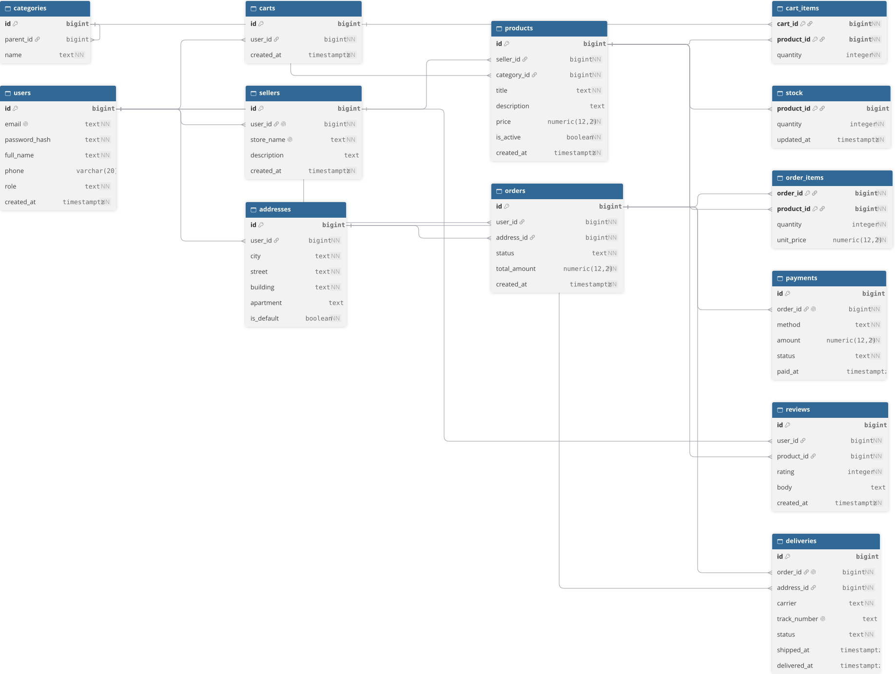

# Лабораторная работа №1. Проектирование и создание структуры базы данных маркетплейса

## Цель работы

Спроектировать и реализовать структуру базы данных маркетплейса средствами PostgreSQL: определить сущности и связи, привести схему к третьей нормальной форме, реализовать DDL-скрипт и составить словарь данных.

## 1. Бизнес-правила предметной области

| № | Правило | Чем обеспечивается |
|---|---|---|
| 1 | Пользователь обязан иметь email | `users.email NOT NULL` |
| 2 | Email уникален | `users.email UNIQUE` |
| 3 | Пользователь может быть покупателем и/или продавцом | `users.role`, `sellers.user_id` |
| 4 | У продавца ровно один владелец | `sellers.user_id UNIQUE NOT NULL` |
| 5 | У пользователя не более одного магазина | `sellers.user_id UNIQUE` |
| 6 | У товара ровно один продавец | `products.seller_id NOT NULL REFERENCES sellers(id)` |
| 7 | У товара ровно одна категория | `products.category_id NOT NULL REFERENCES categories(id)` |
| 8 | Цена товара обязательна | `products.price NOT NULL` |
| 9 | Цена строго положительна | `products.price CHECK (price > 0)` |
| 10 | Заказ не может существовать без пользователя | `orders.user_id NOT NULL` |
| 11 | У заказа ровно один адрес доставки | `orders.address_id NOT NULL` |
| 12 | При удалении заказа его позиции удаляются автоматически | `order_items.order_id ... ON DELETE CASCADE` |
| 13 | Один пользователь — один отзыв на товар | `reviews UNIQUE (user_id, product_id)` |
| 14 | Оценка в отзыве — от 1 до 5 | `reviews.rating CHECK (rating BETWEEN 1 AND 5)` |
| 15 | Категория может иметь родительскую категорию | `categories.parent_id REFERENCES categories(id)` |

## 2. ER-диаграмма



Схема содержит **13 сущностей** (требование: не менее 10):

- `users` — пользователи;
- `sellers` — магазины-продавцы;
- `addresses` — адреса пользователей;
- `categories` — иерархический классификатор товаров;
- `products` — товары;
- `stock` — складские остатки;
- `carts` — корзины;
- `cart_items` — позиции корзин;
- `orders` — заказы;
- `order_items` — позиции заказов;
- `payments` — платежи;
- `reviews` — отзывы;
- `deliveries` — доставки.

Связи по типам:

- **Один-ко-многим (1:N)** — продавец → товары, пользователь → адреса, пользователь → заказы.
- **Многие-ко-многим (M:N)** — заказы ↔ товары через ассоциативную таблицу `order_items`; корзины ↔ товары через `cart_items`.
- **Иерархия (самоссылка)** — категории через `categories.parent_id → categories.id`.
- **Один-к-одному (1:1)** — товар ↔ остаток (`stock`), заказ ↔ платёж (`payments`), заказ ↔ доставка (`deliveries`).

## 3. Нормализация

### Аномалии денормализованной схемы

Рассмотрим денормализованную таблицу, в которой смешаны данные о заказе, пользователе, товаре и продавце:

    orders_denormalized(
        order_id, order_status, created_at,
        user_email, user_full_name, user_phone,
        product_title, product_price,
        seller_name,
        quantity, unit_price
    )

Такая схема порождает три вида аномалий:

- **Аномалия вставки.** Нельзя зарегистрировать нового пользователя, пока он не сделал заказ: строка требует `product_title` и `quantity`, а заказа нет.
- **Аномалия обновления.** При смене телефона пользователя придётся обновлять его во всех строках его заказов. Пропуск хотя бы одной строки приводит к рассогласованию данных.
- **Аномалия удаления.** Удаление последнего заказа пользователя приводит к потере всех сведений о нём.

Причина — смешение в одной таблице нескольких независимых сущностей и наличие функциональных зависимостей не от того ключа:

- `order_id → order_status, created_at`;
- `user_email → user_full_name, user_phone`;
- `product_title → product_price, seller_name`;
- `(order_id, product_title) → quantity, unit_price`.

### Приведение к 3НФ

**1НФ.** Все значения атомарны: в одной ячейке — одно неделимое значение. В нашей схеме нет массивов и списков в столбцах.

**2НФ.** Каждый неключевой атрибут зависит от всего составного первичного ключа, а не от его части. Актуально для таблиц `order_items (order_id, product_id)` и `cart_items (cart_id, product_id)`. В `order_items` атрибуты `quantity` и `unit_price` зависят от всей пары, а данные товара (`title`, `price`) вынесены в `products`.

**3НФ.** Устранены транзитивные зависимости: неключевой атрибут не зависит от другого неключевого. Например, `seller_name` вынесен в `sellers`, а в `products` остался только `seller_id`.

### Разбиение

- `users` — данные пользователя;
- `sellers` — данные магазина (со ссылкой на владельца-пользователя);
- `products` — данные товара (со ссылкой на продавца и категорию);
- `orders` — данные заказа (со ссылкой на пользователя и адрес);
- `order_items` — только атрибуты, зависящие от составного ключа `(order_id, product_id)`.

Все таблицы итоговой схемы находятся в третьей нормальной форме.

## 4. Первичные ключи и их обоснование

В большинстве таблиц используется **суррогатный** первичный ключ `BIGINT GENERATED ALWAYS AS IDENTITY`. Он стабилен (не меняется со временем), компактен (8 байт) и независим от бизнес-правил. Естественные ключи оставлены как `UNIQUE`-ограничения (например, `users.email`, `sellers.store_name`).

| Таблица | Первичный ключ | Тип | Обоснование |
|---|---|---|---|
| `users` | `id` | суррогатный | `email` уникален, но может меняться |
| `sellers` | `id` | суррогатный | `store_name` уникален, но может меняться |
| `addresses` | `id` | суррогатный | адрес не имеет естественного уникального поля |
| `categories` | `id` | суррогатный | `(parent_id, name)` уникален, но композитный и зависит от иерархии |
| `products` | `id` | суррогатный | названия товаров повторяются у разных продавцов |
| `stock` | `product_id` | естественный | связь 1:1, отдельный `id` избыточен |
| `carts` | `id` | суррогатный | нет естественного уникального поля |
| `cart_items` | `(cart_id, product_id)` | композитный | ассоциативная таблица M:N |
| `orders` | `id` | суррогатный | нет естественного уникального поля |
| `order_items` | `(order_id, product_id)` | композитный | ассоциативная таблица M:N |
| `payments` | `id` | суррогатный | платёж может повторяться по сумме и методу |
| `reviews` | `id` | суррогатный | альтернативный ключ `UNIQUE (user_id, product_id)` |
| `deliveries` | `id` | суррогатный | нет естественного уникального поля |

В таблицах `stock`, `cart_items`, `order_items` используются естественные и композитные ключи: в них суррогатный `id` был бы избыточен.

## 5. DDL-скрипт

Полный скрипт создания схемы — в файле [`schema.sql`](schema.sql). Скрипт оформлен в одной транзакции (`BEGIN ... COMMIT`) и может быть выполнен повторно: перед созданием таблиц выполняется `DROP TABLE IF EXISTS ... CASCADE`.

Запуск:

'''bash
psql -d marketplace_lab1 -f schema.sql
'''

## 6. Словарь данных

### `users` — пользователи

| Столбец | Тип | Ограничения | Назначение |
|---|---|---|---|
| id | BIGINT | PK, IDENTITY | Суррогатный ключ |
| email | TEXT | NOT NULL, UNIQUE | Логин |
| password_hash | TEXT | NOT NULL | Хеш пароля |
| full_name | TEXT | NOT NULL | ФИО |
| phone | VARCHAR(20) | — | Телефон |
| role | TEXT | NOT NULL, DEFAULT 'customer', CHECK IN ('customer','seller','admin') | Роль |
| created_at | TIMESTAMPTZ | NOT NULL, DEFAULT now() | Дата регистрации |

### `sellers` — магазины

| Столбец | Тип | Ограничения | Назначение |
|---|---|---|---|
| id | BIGINT | PK, IDENTITY | Суррогатный ключ |
| user_id | BIGINT | NOT NULL, UNIQUE, FK → users.id | Владелец |
| store_name | TEXT | NOT NULL, UNIQUE | Название магазина |
| description | TEXT | — | Описание |
| created_at | TIMESTAMPTZ | NOT NULL, DEFAULT now() | Дата создания |

### `addresses` — адреса

| Столбец | Тип | Ограничения | Назначение |
|---|---|---|---|
| id | BIGINT | PK, IDENTITY | Суррогатный ключ |
| user_id | BIGINT | NOT NULL, FK → users.id | Владелец |
| city | TEXT | NOT NULL | Город |
| street | TEXT | NOT NULL | Улица |
| building | TEXT | NOT NULL | Дом |
| apartment | TEXT | — | Квартира |
| is_default | BOOLEAN | NOT NULL, DEFAULT FALSE | Адрес по умолчанию |

### `categories` — категории

| Столбец | Тип | Ограничения | Назначение |
|---|---|---|---|
| id | BIGINT | PK, IDENTITY | Суррогатный ключ |
| parent_id | BIGINT | FK → categories.id | Родительская категория |
| name | TEXT | NOT NULL | Название |

### `products` — товары

| Столбец | Тип | Ограничения | Назначение |
|---|---|---|---|
| id | BIGINT | PK, IDENTITY | Суррогатный ключ |
| seller_id | BIGINT | NOT NULL, FK → sellers.id | Продавец |
| category_id | BIGINT | NOT NULL, FK → categories.id | Категория |
| title | TEXT | NOT NULL | Название |
| description | TEXT | — | Описание |
| price | NUMERIC(12,2) | NOT NULL, CHECK > 0 | Цена |
| is_active | BOOLEAN | NOT NULL, DEFAULT TRUE | Опубликован |
| created_at | TIMESTAMPTZ | NOT NULL, DEFAULT now() | Дата добавления |

### `stock` — складские остатки

| Столбец | Тип | Ограничения | Назначение |
|---|---|---|---|
| product_id | BIGINT | PK, FK → products.id | Товар (1:1) |
| quantity | INTEGER | NOT NULL, CHECK ≥ 0 | Количество |
| updated_at | TIMESTAMPTZ | NOT NULL, DEFAULT now() | Дата обновления |

### `carts` — корзины

| Столбец | Тип | Ограничения | Назначение |
|---|---|---|---|
| id | BIGINT | PK, IDENTITY | Суррогатный ключ |
| user_id | BIGINT | NOT NULL, FK → users.id | Владелец |
| created_at | TIMESTAMPTZ | NOT NULL, DEFAULT now() | Дата создания |

### `cart_items` — позиции корзин

| Столбец | Тип | Ограничения | Назначение |
|---|---|---|---|
| cart_id | BIGINT | PK (часть), FK → carts.id | Корзина |
| product_id | BIGINT | PK (часть), FK → products.id | Товар |
| quantity | INTEGER | NOT NULL, CHECK > 0 | Количество |

### `orders` — заказы

| Столбец | Тип | Ограничения | Назначение |
|---|---|---|---|
| id | BIGINT | PK, IDENTITY | Суррогатный ключ |
| user_id | BIGINT | NOT NULL, FK → users.id | Покупатель |
| address_id | BIGINT | NOT NULL, FK → addresses.id | Адрес доставки |
| status | TEXT | NOT NULL, DEFAULT 'new', CHECK IN ('new','paid','shipped','delivered','cancelled') | Статус |
| total_amount | NUMERIC(12,2) | NOT NULL, CHECK ≥ 0 | Сумма |
| created_at | TIMESTAMPTZ | NOT NULL, DEFAULT now() | Дата оформления |

### `order_items` — позиции заказов

| Столбец | Тип | Ограничения | Назначение |
|---|---|---|---|
| order_id | BIGINT | PK (часть), FK → orders.id | Заказ |
| product_id | BIGINT | PK (часть), FK → products.id | Товар |
| quantity | INTEGER | NOT NULL, CHECK > 0 | Количество |
| unit_price | NUMERIC(12,2) | NOT NULL, CHECK > 0 | Цена на момент заказа |

### `payments` — платежи

| Столбец | Тип | Ограничения | Назначение |
|---|---|---|---|
| id | BIGINT | PK, IDENTITY | Суррогатный ключ |
| order_id | BIGINT | NOT NULL, UNIQUE, FK → orders.id | Заказ (1:1) |
| method | TEXT | NOT NULL, CHECK IN ('card','sbp','cash_on_delivery') | Способ оплаты |
| amount | NUMERIC(12,2) | NOT NULL, CHECK > 0 | Сумма |
| status | TEXT | NOT NULL, DEFAULT 'pending', CHECK IN ('pending','succeeded','failed','refunded') | Статус |
| paid_at | TIMESTAMPTZ | — | Дата оплаты |

### `reviews` — отзывы

| Столбец | Тип | Ограничения | Назначение |
|---|---|---|---|
| id | BIGINT | PK, IDENTITY | Суррогатный ключ |
| user_id | BIGINT | NOT NULL, FK → users.id | Автор |
| product_id | BIGINT | NOT NULL, FK → products.id | Товар |
| rating | INTEGER | NOT NULL, CHECK 1–5 | Оценка |
| body | TEXT | — | Текст отзыва |
| created_at | TIMESTAMPTZ | NOT NULL, DEFAULT now() | Дата |

Уникальность: `UNIQUE (user_id, product_id)` — один отзыв на товар от одного пользователя.

### `deliveries` — доставки

| Столбец | Тип | Ограничения | Назначение |
|---|---|---|---|
| id | BIGINT | PK, IDENTITY | Суррогатный ключ |
| order_id | BIGINT | NOT NULL, UNIQUE, FK → orders.id | Заказ (1:1) |
| address_id | BIGINT | NOT NULL, FK → addresses.id | Адрес |
| carrier | TEXT | NOT NULL | Перевозчик |
| track_number | TEXT | UNIQUE | Трек-номер |
| status | TEXT | NOT NULL, DEFAULT 'waiting', CHECK IN ('waiting','in_transit','delivered','returned') | Статус |
| shipped_at | TIMESTAMPTZ | — | Дата отправки |
| delivered_at | TIMESTAMPTZ | — | Дата доставки |

## 7. Воспроизводимость

Скрипт `schema.sql` выполняется повторно и воссоздаёт схему с нуля:

```bash
psql -d marketplace_lab1 -f schema.sql
```

Проверка:

```sql
SELECT table_name FROM information_schema.tables
WHERE table_schema = 'public'
ORDER BY table_name;
```

Должно вернуться 13 таблиц.
